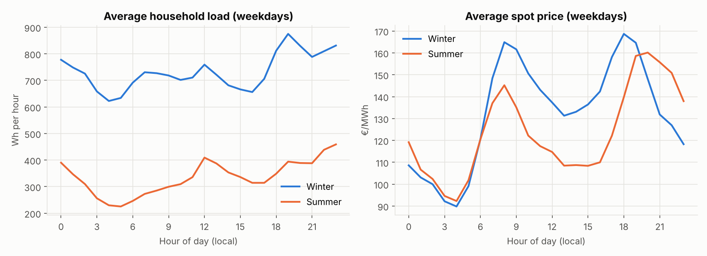
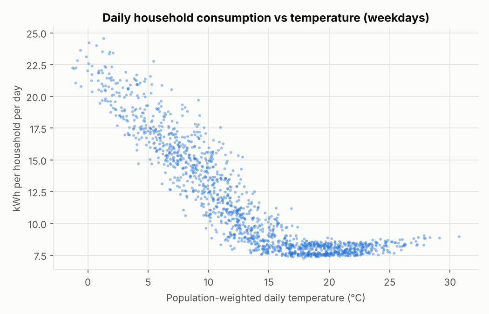
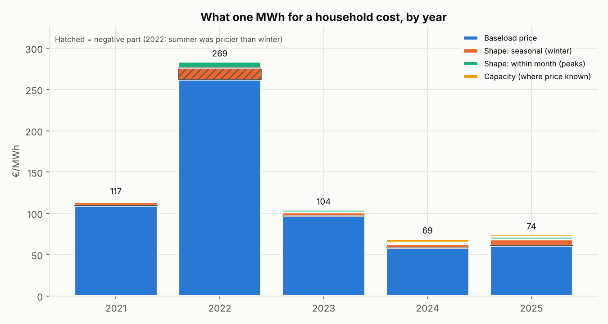
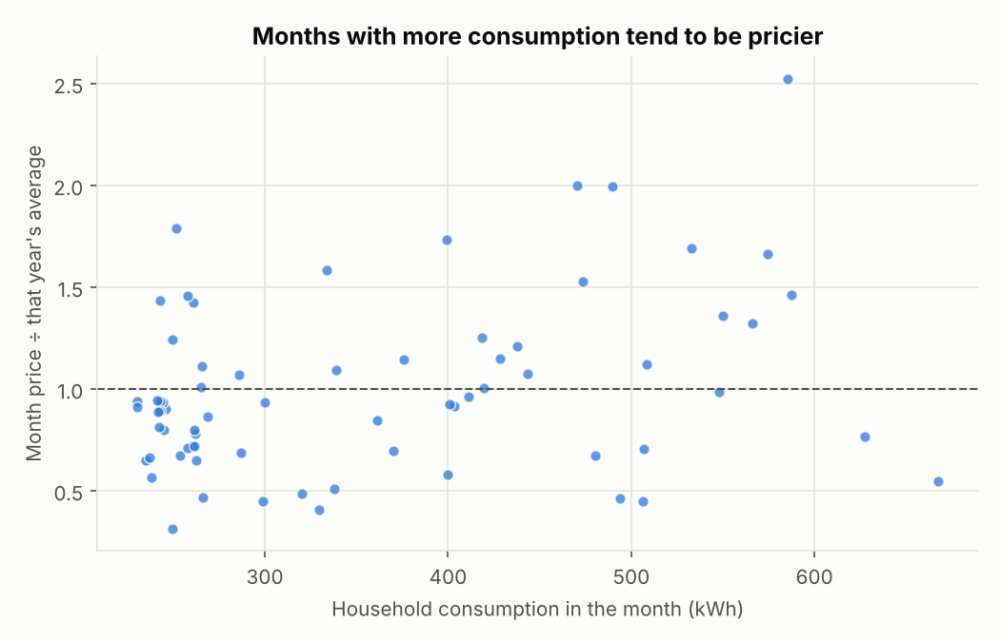
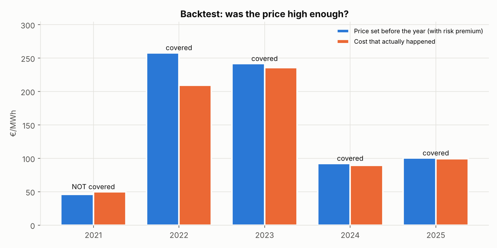
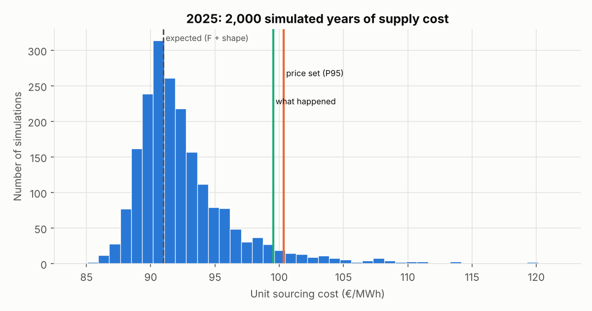
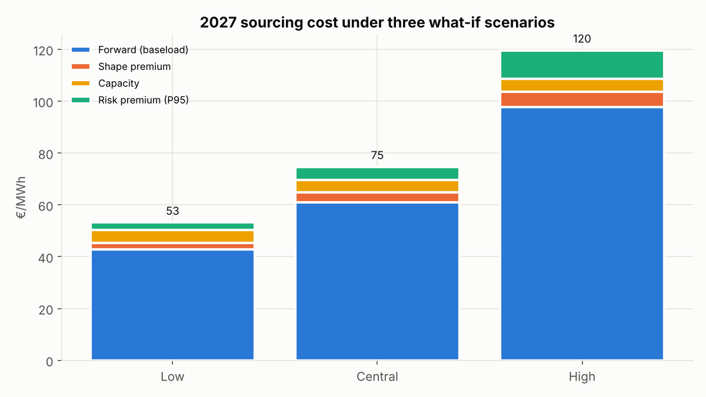

# What does it cost to supply a French household with electricity?

A cost-to-serve and risk-premium model for a fixed-price residential electricity offer in France, built only on free public data (2020 to 2025, with a 2027 what-if).

An electricity supplier that sells at a fixed price has to answer three questions before the year starts:

1. **Sourcing cost.** How much more expensive is a household's consumption than a flat baseload block? Households use more in winter and in the evening, when power is expensive. That gap is the *shape premium*.
2. **Risk.** If the winter is cold, customers consume more exactly when spot prices spike. How big can that hit be?
3. **Risk premium.** How much margin (mark-up) has to be built into the price so that it still covers the cost in a bad year, and did that margin actually hold up in the past (backtest)?

This repository answers all three with hourly data, and every number in the results is reproducible with one command.

## Data (all free, downloaded by the code)

| Data | Source | Resolution | Used for |
|---|---|---|---|
| Day-ahead spot price, France | [Energy-Charts API](https://api.energy-charts.info/) (Fraunhofer ISE), no key needed. Optional: ENTSO-E Transparency with a free API key | hourly (15 min since Oct 2025, averaged to hourly) | price of every hour |
| Residential consumption | [Enedis Open Data, `conso-inf36`](https://opendata.enedis.fr/datasets/conso-inf36): national aggregates for meters ≤ 36 kVA | 30 min, from April 2020 | load curve of the average household |
| Temperature | [Open-Meteo historical API](https://open-meteo.com/), 8 large cities, population-weighted | daily, from 1991 | heating demand and 35 "weather years" for simulation |
| Capacity price | public auction results (values with sources in `config.yaml`) | yearly | capacity cost (2024, 2025, 2027 only) |

The cleaned tables are in `data/processed/`. The raw downloads (`data/raw/`) are not committed because of their size, and `run_all.py` downloads them again. Licences: prices CC BY 4.0 (Bundesnetzagentur | SMARD.de, via Energy-Charts), Enedis Open Data (Licence Ouverte / Etalab), Open-Meteo (CC BY 4.0).

## How it works

```
download  ->  clean  ->  ex-post cost stack  ->  fixed-price contract model  ->  backtest + 2027 scenarios  ->  report
```

1. **Clean.** Everything is converted to UTC (no daylight-saving duplicates), then given local calendar features (hour, month, French public holidays). Only the residential profiles and the national "all power ranges" row are kept, summed, and divided by the number of meters to get one average household. Price gaps of up to 3 hours are interpolated. Negative prices and spikes are real market events and are kept. A data-quality report is written to `reports/data_quality.json`.
2. **Ex-post cost stack**, per year:
   - baseload price `B` = simple average of hourly prices
   - load-weighted price `W` = Σ(load × price) / Σ load
   - shape premium `W − B`, split exactly into a *seasonal* part (more MWh in expensive months) and a *within-month* part (evening peaks, cold days)
   - simplified capacity cost
3. **Fixed-price contract.** Before year Y, the supplier buys a flat baseload block equal to the expected average load at a forward price `F`. Real forward prices are not free, so `F` is proxied by the average spot price of Q4 of year Y−1 (you can override this in `config.yaml`). The rest is bought or sold on the spot market.
4. **Risk model**, calibrated only on data *before* year Y:
   - daily household load = f(day type, heating/cooling degree-days, season), with linear regression
   - daily price relative to the yearly average = g(same drivers). Cold days are expensive days, and this is where the price–volume correlation comes from.
   - typical hourly shapes for load and price
   - Monte Carlo (2,000 runs): a random past weather year, bootstrapped 7-day residual blocks, and a lognormal shock on the price level
   - **risk premium = 95th percentile of simulated unit cost − (F + expected shape premium)**
5. **Backtest 2021–2025.** For each year, compare the price set in advance with what the hedged supply actually cost, and split the gap into "unhedged price move" and "shape surprise".
6. **2027 scenarios.** Low / central / high forward levels (×0.7 / ×1.0 / ×1.6 of the last 12 months of spot) with different volatilities. These are what-ifs, not forecasts.

## Run it

```bash
git clone https://github.com/<your-user>/french-retail-power-costing.git
cd french-retail-power-costing
pip install -r requirements.txt
python run_all.py            # first run downloads the data (about 15-30 min, the price API allows ~2 calls/min)
python run_all.py --skip-download   # later runs
python run_all.py --from-processed  # analysis only, from the cleaned CSVs already in data/processed
pytest -q                    # tests (run on synthetic data, no internet needed)
```

Outputs:

- `reports/results_summary.md`: all tables and key numbers, written by the code
- `reports/figures/`: 7 charts
- `reports/tables/`: CSV tables (cost stack, backtest, scenarios, monthly view)
- `data/processed/hourly_master.csv`: the clean hourly dataset, ready for Power BI

## Results (real data, April 2020 – December 2025)

Average French household: **4.18 MWh per year**, about 32.9 million residential meters.

### 1. Households use the most power exactly when it is expensive



On winter weekdays, household load peaks at **19:00** (0.88 kWh in the hour) and the spot price peaks at **18:00** (169 €/MWh). Both bottom out at 04:00. In summer, solar pushes the midday price down to about 108 €/MWh, while the evening peak stays.

### 2. Cold weather drives consumption



Below about 15 °C, each degree colder adds about **0.9 kWh per household per day**. A day below 0 °C averages **22 kWh**, close to 3 times a mild day above 18 °C (**8 kWh**).

### 3. The shape premium: a household MWh usually costs more than a flat MWh



| Year | Baseload price | Household (load-weighted) price | Shape premium | % of baseload |
|---|---|---|---|---|
| 2021 | 109.2 | 116.7 | **+7.5** | 6.9% |
| 2022 | 275.9 | 269.4 | **−6.4** | −2.3% |
| 2023 | 96.9 | 104.2 | **+7.4** | 7.6% |
| 2024 | 58.0 | 64.7 | **+6.7** | 11.6% |
| 2025 | 61.1 | 71.8 | **+10.7** | 17.5% |

*€/MWh. Capacity cost adds 4.5 €/MWh (2024) and 2.5 €/MWh (2025), the only years with a sourced capacity price.*

- In normal years, about **two-thirds** of the premium is seasonal (more MWh in expensive winter months). The rest comes from daily peaks.
- **2022 is the exception.** Nuclear outages and the gas crisis made late summer the most expensive period (August averaged about 490 €/MWh), when households consume little. So for once, a household MWh was *cheaper* than baseload.
- The premium is **growing as a share of the price** (7% → 17.5%). Cheap solar hours at midday pull the baseload average down, but households keep consuming in the evening.



Months with higher consumption tend to have higher prices relative to their year (correlation 0.33, or 0.46 without 2022).

### 4. Backtest of a fixed-price contract (P95 risk premium)



| Year | Forward proxy | Risk premium | Price set in advance | Actual cost | Covered? |
|---|---|---|---|---|---|
| 2021 | 42.2 | 1.9 | 46.2 | 49.9 | **no** |
| 2022 | 221.4 | 24.3 | 257.9 | 209.1 | yes |
| 2023 | 214.1 | 19.5 | 241.7 | 236.0 | yes |
| 2024 | 80.5 | 8.7 | 92.4 | 89.6 | yes |
| 2025 | 86.8 | 9.4 | 100.4 | 99.5 | yes |

Covered in **4 of 5 years**. What the backtest teaches:

- **2021 failed** because the model had only 9 months of history (thin calibration) and the shape premium came in 5.4 €/MWh above expectation.
- **2023: the costly mistake was over-hedging, not prices.** Consumption fell after the 2022 crisis (2021: 4.8 MWh, 2023: 4.2 MWh per household), so the baseload block bought in advance covered **112%** of real consumption. The surplus was resold at about 97 €/MWh after being bought at 214, which added 14.5 €/MWh.
- **2024–2025:** covered, but only just (margins of 2.7 and 0.8 €/MWh). The model under-predicts the growing shape premium (expected 3–4, actual 7–11 €/MWh) most likely because the price patterns it learned still include 2022.



### 5. 2027 what-if



| Scenario | Forward | Shape | Capacity | Risk premium | **Total** |
|---|---|---|---|---|---|
| Low (×0.7, vol 20%) | 42.8 | 2.6 | 4.9 | 3.0 | **53.2** |
| Central (×1.0, vol 30%) | 61.1 | 3.7 | 4.9 | 5.0 | **74.7** |
| High (×1.6, vol 50%) | 97.7 | 6.0 | 4.9 | 11.1 | **119.6** |

*€/MWh, energy sourcing only. Multipliers are applied to the last 12 months' average spot price (61.1 €/MWh). These are what-ifs, not forecasts.*

The risk premium grows faster than the price level: it is 3.7 times larger in the high case, for a forward only 2.3 times higher.

All numbers: [`reports/results_summary.md`](reports/results_summary.md). Clean data: `data/processed/` (open `hourly_master.csv` in Excel or Power BI).

## Limitations (on purpose, stated up front)

- **Forward prices are proxied** by past spot prices. In 2022 the real calendar forwards were much higher than any spot proxy, so hedge results for 2022–2023 should be read as an illustration of the method rather than of the real market. Real forwards can be entered in `config.yaml`.
- **Pure market sourcing.** The model assumes a supplier buying everything on the wholesale market. It ignores ARENH (the regulated access to nuclear power that ended in 2025) and the mechanism that replaced it.
- **Simplified capacity obligation** (average winter weekday peak load, no security coefficient or PP1 days). Capacity prices are only filled where a public source was found.
- **One average household.** Real portfolios mix tariff options (Base, Heures Creuses, Tempo), and some of these profiles (`RES1`, `RES2`, …) are partly reconstructed by Enedis for meters without a smart meter.
- **Simple statistical models** (linear regressions, bootstrap). They are easy to explain and check, but they won't capture events like the 2022 nuclear outages. The backtest shows where this breaks.
- No network costs (TURPE), taxes or commercial margin. This is the **energy sourcing** part of the price only.

## Project structure

```
config.yaml            all assumptions in one place
run_all.py             runs everything
src/costing/
  download.py          API downloads with caching and retries
  clean.py             cleaning, calendar features, data-quality report
  cost_stack.py        ex-post shape premium and capacity cost
  risk_model.py        load & price models, Monte Carlo, contract pricing
  backtest.py          backtest and 2027 scenarios
  plots.py, report.py  charts and markdown summary
tests/                 synthetic raw files in the APIs' formats + tests
```

## Author

Waqas Saleem, environmental & energy engineer, Paris. Data attribution: Bundesnetzagentur | SMARD.de via Energy-Charts.info (CC BY 4.0), Enedis Open Data, Open-Meteo.com (CC BY 4.0).
