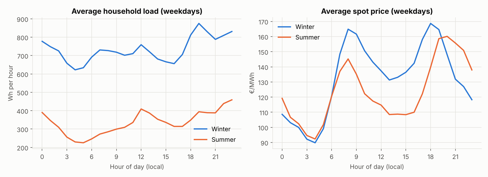
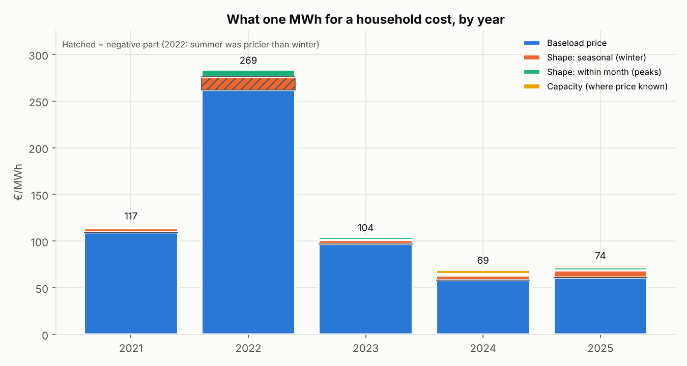
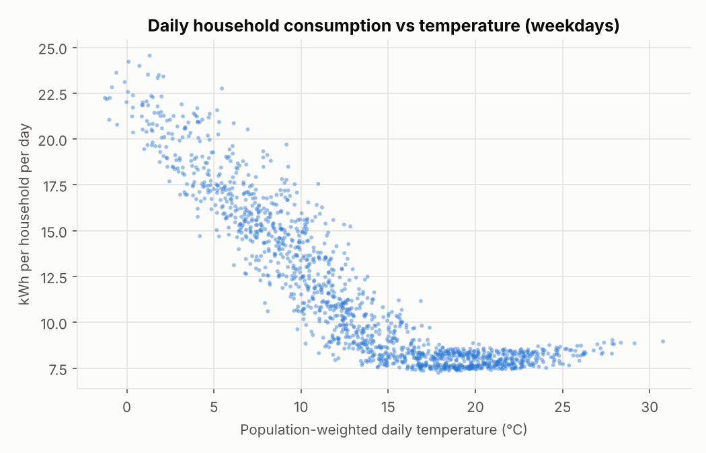
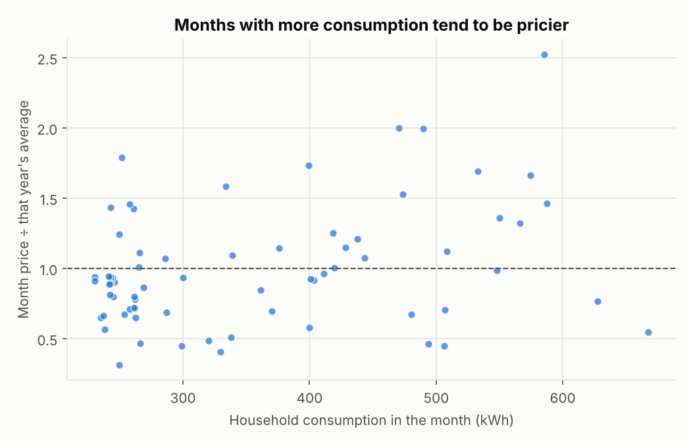
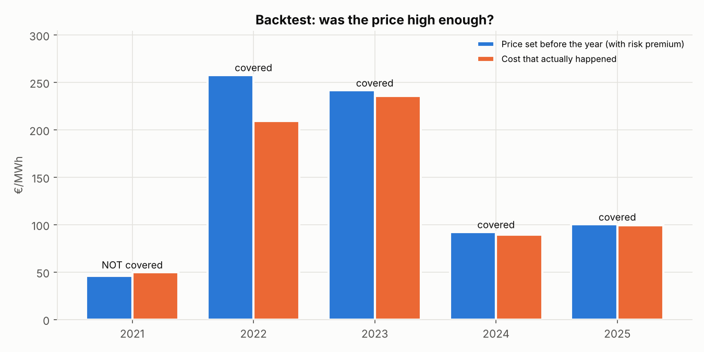
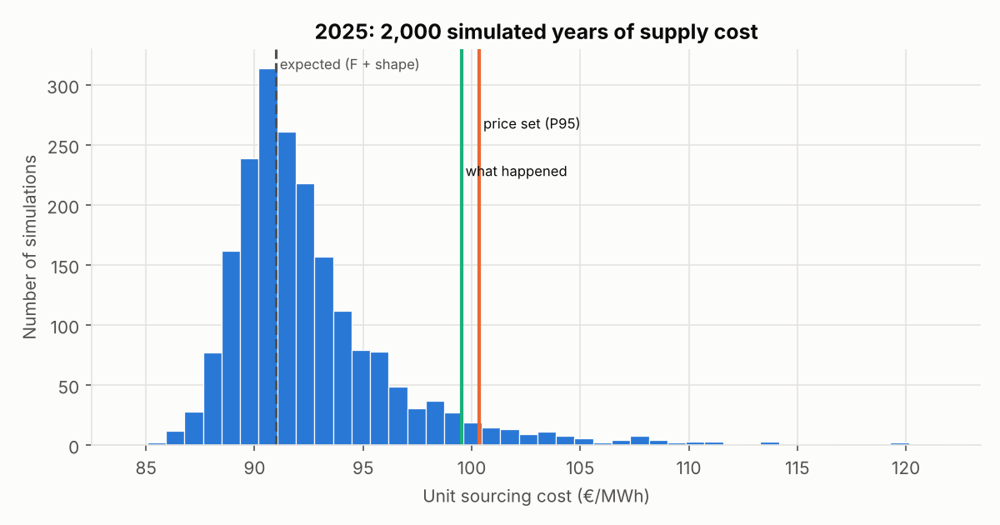
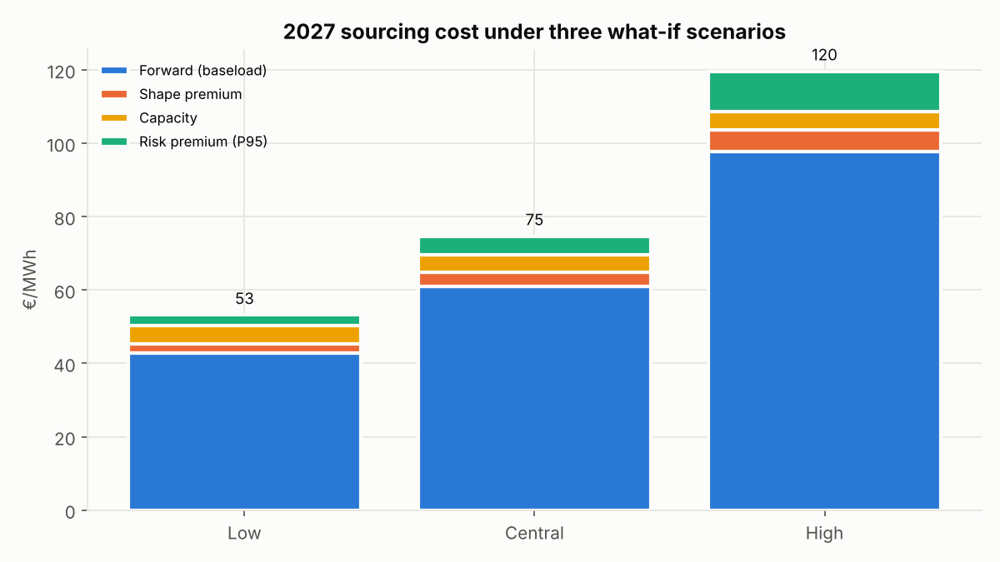

# Results summary

_Generated automatically by `run_all.py`. All values in €/MWh unless stated._

## Data used

- Analysis window: 2020-04-01 00:00:00 → 2025-12-31 23:00:00 (50,425 hours with both load and price)
- Average household consumption: 4.18 MWh/year
- Average number of residential meters in the data: 32,932,377
- Price hours: 87,672; negative-price hours: 1,226; hours above 500 €/MWh: 740

## 1. What did it cost to supply a household? (ex-post)

| year | baseload_price | load_weighted_price | shape_premium | shape_seasonal | shape_intra_month | shape_premium_pct | capacity_cost | price_load_correlation |
|---|---|---|---|---|---|---|---|---|
| 2021 | 109.17 | 116.71 | 7.54 | 4.69 | 2.86 | 6.91 | n/a | 0.23 |
| 2022 | 275.88 | 269.43 | -6.45 | -14.18 | 7.73 | -2.34 | n/a | -0.11 |
| 2023 | 96.86 | 104.23 | 7.37 | 4.39 | 2.99 | 7.61 | n/a | 0.42 |
| 2024 | 58.02 | 64.74 | 6.73 | 5.03 | 1.69 | 11.59 | 4.46 | 0.44 |
| 2025 | 61.07 | 71.78 | 10.70 | 7.67 | 3.04 | 17.53 | 2.51 | 0.58 |

- A household MWh cost more than a flat baseload MWh in **4 of 5** years. The largest shape premium was in **2025**: **10.7 €/MWh** (17.5% of baseload).
- In those years, the seasonal effect (more MWh in expensive winter months) explains about **67%** of the premium (median); the rest comes from daily peaks.
- **2022** is the exception: shape premium **-6.4 €/MWh**. The seasonal part is -14.2 €/MWh, i.e. the months when households consume little were the most expensive ones.

## 2. Backtest of the fixed-price contract

| year | forward_proxy | expected_shape_premium | risk_premium | offered_energy_price | realised_unit_cost | margin_vs_offer | covered | percentile_of_outcome | dev_unhedged_price_move | dev_shape_surprise |
|---|---|---|---|---|---|---|---|---|---|---|
| 2021 | 42.2 | 2.1 | 1.9 | 46.2 | 49.9 | -3.7 | no | 100.0 | 0.2 | 5.4 |
| 2022 | 221.4 | 12.2 | 24.3 | 257.9 | 209.1 | 48.8 | yes | 0.0 | -5.9 | -18.6 |
| 2023 | 214.1 | 8.0 | 19.5 | 241.7 | 236.0 | 5.7 | yes | 90.2 | 14.5 | -0.7 |
| 2024 | 80.5 | 3.2 | 8.7 | 92.4 | 89.6 | 2.7 | yes | 90.2 | 2.4 | 3.5 |
| 2025 | 86.8 | 4.2 | 9.4 | 100.4 | 99.5 | 0.8 | yes | 94.0 | 2.1 | 6.5 |

- The price set before the year covered the real cost in **4 of 5** years (target: 95% of outcomes).
- `dev_unhedged_price_move` = cost of buying the unhedged share at a spot price different from the forward; `dev_shape_surprise` = realised shape premium minus expected.

- Note 2021: thin calibration: only 275 days of load history before 2021

## 3. 2027 what-if scenarios

Reference = average spot price over the last 12 months of data: **61.1 €/MWh**. Scenarios are illustrative, not forecasts.

| scenario | forward_level | level_vol | expected_shape_premium | capacity_cost | risk_premium | total_sourcing_cost |
|---|---|---|---|---|---|---|
| low | 42.8 | 0.2 | 2.6 | 4.9 | 3.0 | 53.2 |
| central | 61.1 | 0.3 | 3.7 | 4.9 | 5.0 | 74.7 |
| high | 97.7 | 0.5 | 6.0 | 4.9 | 11.1 | 119.6 |

## Charts

